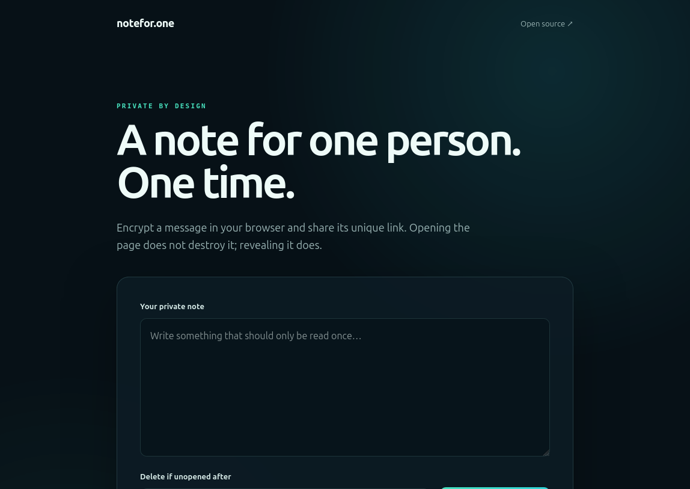
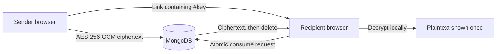

# notefor.one

[](https://github.com/lucaspiressimao/notefor.one/actions/workflows/ci.yml)
[](https://github.com/lucaspiressimao/notefor.one/actions/workflows/codeql.yml)
[](LICENSE)
[](package.json)

Share an end-to-end encrypted note that disappears after one person reveals it. No accounts, trackers, plaintext storage, or server-side encryption keys.



## Why notefor.one?

- **Encrypted before upload:** AES-256-GCM runs in the sender's browser through the Web Crypto API.
- **One-time by construction:** MongoDB atomically removes a note as it is consumed, including under concurrent requests.
- **Preview-safe:** opening a link does not consume it; the recipient must explicitly choose to reveal it.
- **Automatic expiration:** unopened notes are removed by a MongoDB TTL index after 15 minutes, 1 hour, 24 hours, or 7 days.
- **Small and self-hostable:** the frontend is dependency-free static HTML, CSS, and JavaScript; the server is a focused Node/Express API.
- **Hardened defaults:** CSP, HSTS, no-referrer, restricted browser permissions, rate limiting, payload limits, non-root container, and secret scanning.

## How it works



The random 256-bit key lives after `#` in the URL. [URL fragments are not included in HTTP requests](https://developer.mozilla.org/en-US/docs/Web/URI/Reference/Fragment), so the application server and MongoDB never receive the key. The server stores only ciphertext, an IV, a 144-bit random identifier, and timestamps.

## Quick start

Requirements: Node.js 20.19 or newer. The local memory store requires no database and intentionally loses all notes when the process stops.

```bash
git clone https://github.com/lucaspiressimao/notefor.one.git
cd notefor.one
nvm use
npm ci
MEMORY_STORE=true npm start
```

Open `http://localhost:3000`.

## Production with Docker

Production requires MongoDB and HTTPS. Build and run the non-root container:

```bash
docker build -t notefor-one:2 .
docker run --read-only --tmpfs /tmp --init \
  -e MONGO_URL='mongodb://mongo:27017' \
  -e MONGO_DB='notefor_one' \
  -e TRUST_PROXY='true' \
  -p 3000:3000 \
  notefor-one:2
```

Terminate TLS at one trusted reverse proxy, keep MongoDB on a private authenticated network, and expose only the application port. `TRUST_PROXY=true` must be used only behind exactly one trusted proxy.

## Configuration

| Variable | Required | Description |
| --- | --- | --- |
| `MONGO_URL` | Production | MongoDB connection string |
| `MONGO_DB` | No | Database name; defaults to `notefor_one` |
| `MONGO_POOL_SIZE` | No | Connection pool size; defaults to `10` |
| `PORT` | No | HTTP port; defaults to `3000` |
| `HOST` | No | Listen address; defaults to `0.0.0.0` |
| `TRUST_PROXY` | No | Trust exactly one reverse proxy when set to `true` |
| `MEMORY_STORE` | Development only | Store ephemeral notes in process memory |

Copy [.env.example](.env.example) to `.env` when running with MongoDB. Legacy `SECRET`, `IV`, `ALGORITHM`, and `PUBLIC_URL` variables are no longer used.

## Development and verification

```bash
npm test
npm audit --audit-level=low
docker build -t notefor-one:test .
```

Every pull request runs the test suite on Node.js 20 and 24, builds the production container, and receives CodeQL analysis. Dependabot monitors npm, Docker, and GitHub Actions dependencies weekly.

## Security

Read the [security model and deployment guidance](SECURITY.md) before hosting this service. Please report vulnerabilities through the repository's **Security → Report a vulnerability** flow rather than a public issue.

The design protects stored content from database-only compromise, accidental link previews, and duplicate consumption. It cannot protect plaintext after reveal, compromised endpoints or browsers, screenshots, malicious extensions, a compromised application host serving altered JavaScript, or deployments without HTTPS.

## Contributing

Bug reports, design discussions, documentation improvements, tests, and code contributions are welcome. Start with [CONTRIBUTING.md](CONTRIBUTING.md), browse the [issues](https://github.com/lucaspiressimao/notefor.one/issues), or open a [discussion](https://github.com/lucaspiressimao/notefor.one/discussions).

## Version 2 migration

Version 2 is intentionally incompatible with the legacy crypto and API design. Existing ephemeral notes remain in the legacy collection and are not migrated. New notes use the `notes_v2` collection. See the [changelog](CHANGELOG.md) for the security rationale.

## Acknowledgements

notefor.one was originally based on [Joshua Terrill's Hushnote](https://github.com/joshterrill/hushnote), licensed under MIT. Version 2 substantially rewrites the application while preserving attribution in [LICENSE](LICENSE).

## License

[MIT](LICENSE) — use, modify, and distribute it freely while retaining the license notice.
